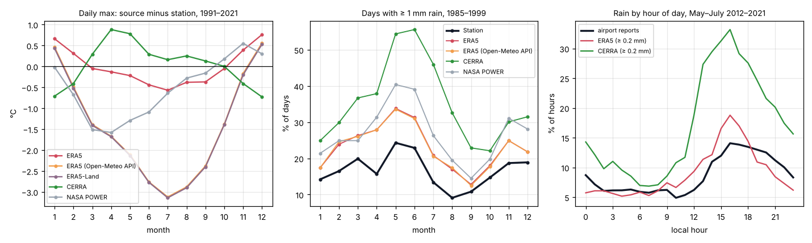

# All data sources compared with the Plovdiv measurements

_Run on 2026-10-29 with [`research/compare_sources.py`](../../research/compare_sources.py) and [`research/validate_vs_station.py`](../../research/validate_vs_station.py), for issue [#3](https://github.com/valentina98/weather-odds/issues/3) ("test all databases before you implement anything"). Numbers are in [all-sources.json](all-sources.json) and [validation-station.json](validation-station.json)._

**Short answer**
- **Temperature:** the best source for Plovdiv is the **station's own measurements**. Meteostat has the station's hourly temperatures from 1997 on, 99.9% of them observed, not modelled. Using them instead of a grid gives temperature ranges with the right width.
- **Among the grids:** ERA5 with our height correction and ECMWF IFS (9 km, from 2017) match the station best.
- **CERRA (5.5 km) is no better for temperature and clearly worse for rain.** So downloading it from Copernicus is not worth it.
- **Rain:** ERA5 is the best grid, but it counts too many wet days and needs the calibration below. Its hourly rain at 0.2 mm or more matches how often the airport reports rain.
- **Thunder** comes only from the airport reports (2012 on). ERA5's rain misses half of the thunder hours.
- **Warning for the default data path:** the Open-Meteo API's ERA5 product ("ERA5 seamless") uses ERA5-Land temperatures. These are 3 °C too cold in summer at Plovdiv. The tool must ask the API for plain ERA5, or read ERA5 from the AWS bucket as the research does.

_Left: daily maximum, source minus station, by month. Middle: share of days with ≥ 1 mm rain. Right: share of hours with rain by local hour in May–July: airport reports vs ERA5 and CERRA._

## Sources tested

All were downloaded on 2026-10-29 with full network access.

| Source | Type | Plovdiv data | Access |
|---|---|---|---|
| NOAA GSOD | station, daily | temperature 1959–2025 with gaps; rain amounts 1973–1999 | no key |
| Meteostat | station, hourly and daily | **hourly temperature 1997–2026, almost every hour, measured** (3-hourly 1980–1995; 1996 missing); its rain and gusts are model fill-ins, not measurements | no key |
| Airport reports (LBPD, Iowa Environmental Mesonet) | station, every 30 minutes | rain, showers, thunder, snow reported, from 2012 | no key |
| NIMH open data | station, daily | rain amounts 2022–2026 | no key |
| ERA5 | grid 25 km, hourly | 1940– | Open-Meteo AWS bucket (no key, no limit) |
| ERA5-Land | grid 9 km, hourly | 1950– | same |
| ECMWF IFS | grid 9 km, hourly | 2017– | same |
| ERA5 through the Open-Meteo API ("ERA5 seamless") | grid, hourly and daily | 1940– | no key; free daily limit (reached again during these downloads) |
| CERRA through the Open-Meteo API | grid 5.5 km, hourly and daily | 1985 – June 2021 | no key; same limit |
| CERRA through Copernicus | grid 5.5 km | 1984 – July 2026 | key (works) and the dataset licence; only whole-Europe fields, several GB per autumn |
| NASA POWER | grid ~50 km, daily | 1981– | no key |

## Daily maximum temperature

**1991 – June 2021** (10,741 days, every source but IFS)

| Source | Mean difference | Mean absolute difference | Correlation | June–August | December–February |
|---|---|---|---|---|---|
| **ERA5**, height-corrected | 0.0 °C | **1.24 °C** | 0.987 | −0.5 °C | +0.6 °C |
| CERRA (5.5 km) | +0.1 °C | 1.34 °C | 0.986 | +0.2 °C | −0.6 °C |
| NASA POWER | −0.5 °C | 2.15 °C | 0.964 | −0.7 °C | −0.1 °C |
| ERA5-Land, height-corrected | −1.5 °C | 2.41 °C | 0.976 | **−2.9 °C** | +0.2 °C |
| ERA5 through the Open-Meteo API | −1.5 °C | 2.40 °C | 0.976 | **−2.9 °C** | +0.2 °C |

**2017–2025** (3,287 days)

| Source | Mean difference | Mean absolute difference | Correlation |
|---|---|---|---|
| **ECMWF IFS (9 km)** | −0.2 °C | **1.05 °C** | 0.990 |
| ERA5, height-corrected | **+0.6 °C** | 1.20 °C | 0.988 |
| NASA POWER | −0.5 °C | 1.98 °C | 0.967 |
| ERA5 through the Open-Meteo API | −1.4 °C | 2.14 °C | 0.980 |

- **CERRA is not more precise here.** It is close to ERA5 on average, slightly worse day by day, and runs +0.9 °C warm in spring.
- **The Open-Meteo API's "ERA5 seamless" matches ERA5-Land almost exactly** (left panel), including the summer cold bias. Requesting plain ERA5 from the API (`models=era5`) still has to be checked: the free daily limit was used up when I tried.
- **ERA5 drifts away from the station.** ERA5 minus station averaged −0.8 °C in 1991–2000, +0.2 °C in 2001–2010 and +0.6 °C in 2017–2025. Its warming trend since 1996 is +1.20 °C per decade; the station's is +0.76. ECMWF IFS stays within 0.4 °C of the station in every year 2017–2025.

## Which data predicts the station best

Each year 2001–2025 was predicted from the 30 years before it (±7 days, as the tool would) and scored against what the station measured ([validate_vs_station.py](../../research/validate_vs_station.py)):

| Predicted from | Trend-adjusted | Error (CRPS) | Bias | In the 10–90% range (80% is right) |
|---|---|---|---|---|
| **Station** | **yes** | 2.58 °C | **+0.15 °C** | **81%** |
| Station | no | 2.59 °C | +0.48 °C | 83% |
| ERA5 | yes | 2.56 °C | −0.10 °C | 76% |
| ERA5 | no | 2.62 °C | +0.79 °C | 75% |
| ERA5 corrected to the station (monthly) | yes | 2.57 °C | −0.40 °C | 77% |

- The average errors are practically equal.
- **Only the station's own data gets the ranges right**: 81% of days fell in the predicted 10–90% range. ERA5's ranges are too narrow (76%), so the tool would overstate how certain a temperature is.
- A fixed monthly correction does not fix ERA5, because its difference from the station changes over the years.

## Rain

**Days with ≥ 1 mm**

| Period (station) | Station | ERA5 | CERRA | ECMWF IFS | NASA POWER |
|---|---|---|---|---|---|
| 1985–1999 (GSOD) | 16.6% | 23.0% (agrees on 84% of days) | **35.4%** (75%) | – | 26.8% (83%) |
| 2022–2025 (NIMH) | 20.3% | 22.0% (81%) | – | 21.4% (80%) | 28.1% (76%) |

**Rain by hour, compared with the airport reports** (an hour counts as rainy in the model with ≥ 0.2 mm)

| Period | Source | Rainy hours: airport | Rainy hours: model | Model rains when the airport reports rain | Model rains but the airport reports none |
|---|---|---|---|---|---|
| 2012 – June 2021 | ERA5 | 9.1% | 9.3% | 53% | 48% |
| 2012 – June 2021 | CERRA | 9.1% | 12.5% | 58% | 58% |
| 2017–2025 | ERA5 | 9.2% | 8.8% | 54% | 43% |
| 2017–2025 | ECMWF IFS | 9.2% | 8.1% | 51% | 42% |

- **CERRA rains on about twice as many days as the station** and on a third more hours than the airport reports. It is the wettest source.
- **ERA5 at 0.2 mm per hour already rains as often as the airport reports.** The threshold of the outdoor-weather scale fits. It catches about half of the airport's rainy hours, which is normal for a 25 km grid against a single point.
- **ERA5 has too many wet days** compared with the station. A calibrated wet-day threshold fixes the frequency:

| Month | 1 | 2 | 3 | 4 | 5 | 6 | 7 | 8 | 9 | 10 | 11 | 12 |
|---|---|---|---|---|---|---|---|---|---|---|---|---|
| ERA5 mm for a station wet day (GSOD 1973–1999) | 1.4 | 1.7 | 2.1 | 2.0 | 1.9 | 1.9 | 1.7 | 2.2 | 1.7 | 1.2 | 1.6 | 1.4 |
| Same against NIMH 2022–2025 (4 years, noisy) | 0.8 | 2.5 | 1.4 | 1.6 | 1.1 | 1.7 | 0.9 | 0.4 | 0.7 | 1.2 | 1.4 | 1.0 |

The two periods disagree. Either ERA5 has become less wet, or the NIMH files undercount. The longer GSOD period is the safer default (about 1.7 mm); re-check as NIMH years accumulate.

## Thunder

From the airport reports, 2012–2025 (5,113 days):

| Month | 1 | 2 | 3 | 4 | 5 | 6 | 7 | 8 | 9 | 10 | 11 | 12 |
|---|---|---|---|---|---|---|---|---|---|---|---|---|
| Days with thunder | 1% | 0% | 1% | 6% | 17% | **24%** | 14% | 13% | 5% | 2% | 1% | 0% |
| Daylight hours with thunder | 0.1% | 0% | 0.1% | 0.9% | 2.4% | **4.4%** | 1.9% | 1.5% | 0.8% | 0.2% | 0.1% | 0% |

ERA5 shows rain (≥ 0.2 mm within an hour either side) in only 51% of the hours with thunder at the airport. So thunder has to come from the airport reports. The reports start in 2012, so a 30-year reference period has thunder for only 14 of its years; a model stand-in for the earlier years (ERA5 convective rain or CAPE, IFS lightning) is still to be tested.

## Data design for Plovdiv (proposed)

| What | Source | Why |
|---|---|---|
| Temperature (hourly) | **Station** (Meteostat/NOAA ISD, 1997–); ERA5 corrected to the station fills 1996 and missing hours | Right ranges; precision first |
| Trend adjustment | Fitted to the station's temperatures | ERA5 warms faster than the station |
| Rain (hourly, amounts) | ERA5 (AWS bucket or the API with plain ERA5), wet-day threshold calibrated to the station | The only complete hourly rain; matches the airport's frequency at 0.2 mm/h |
| Wind gusts | ERA5 | No measured gusts in the open station data |
| Thunder | Airport reports (2012–); stand-in for earlier years to be tested | ERA5 misses half of the thunder hours |
| CERRA | Not used | No better for temperature, worse for rain |
| ECMWF IFS | Check for recent years | Closest grid to the station since 2017, but only 9 years |

## Reproduce

See [research/README.md](../../research/README.md).
