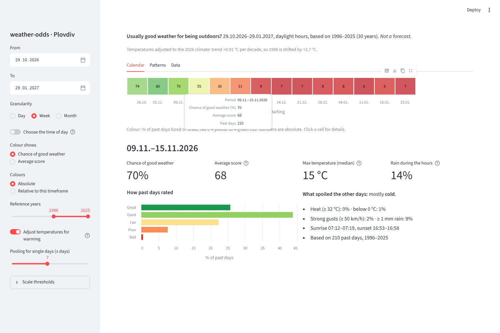
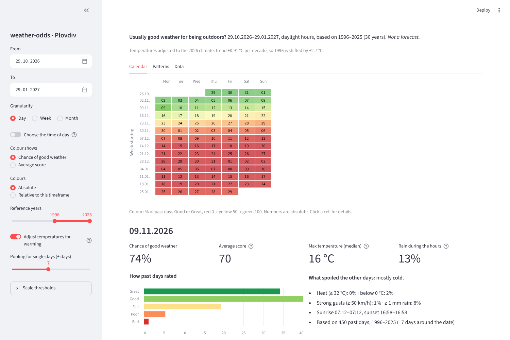
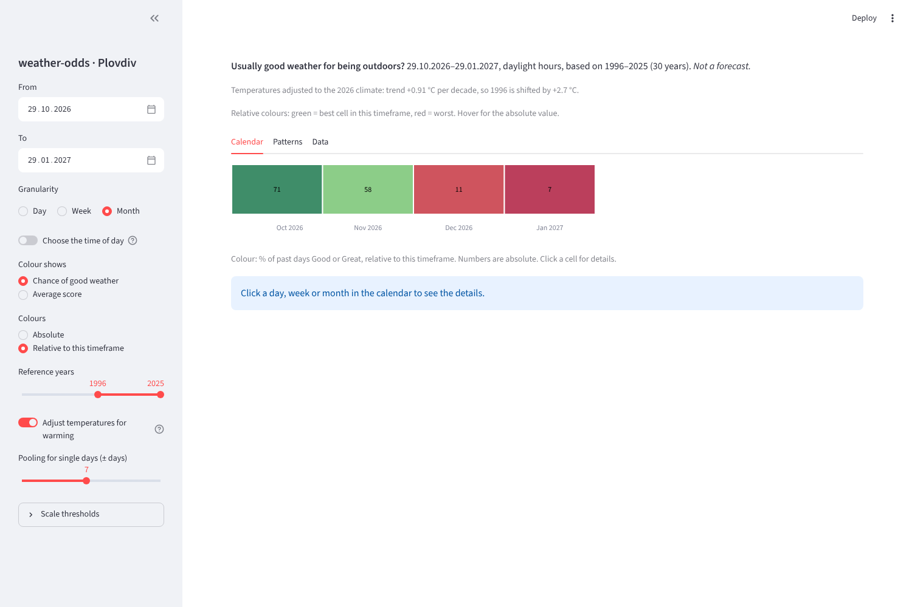
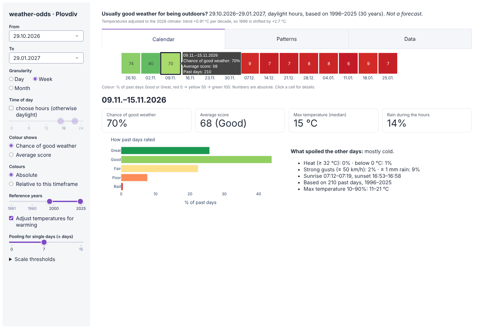
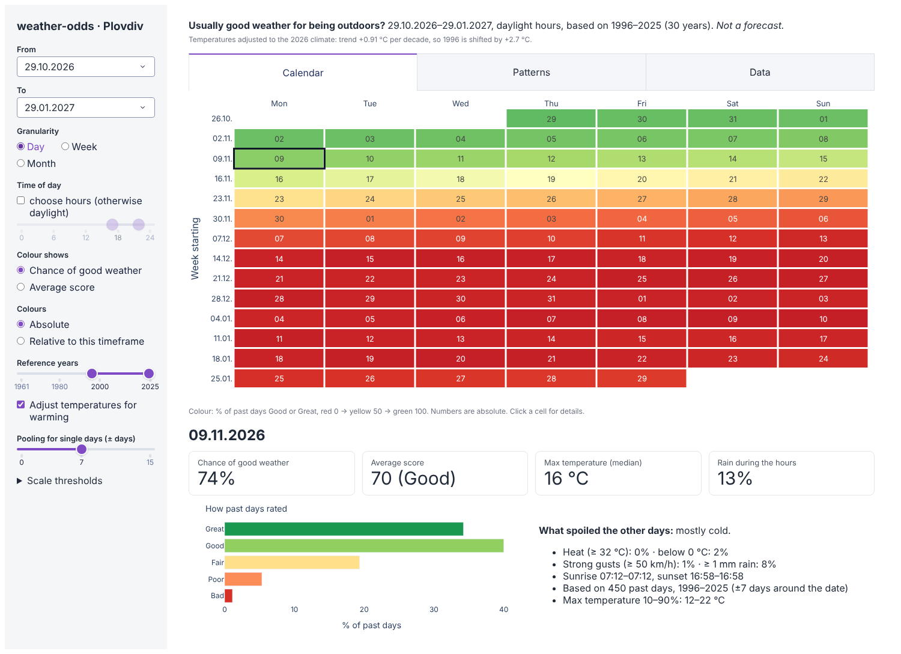
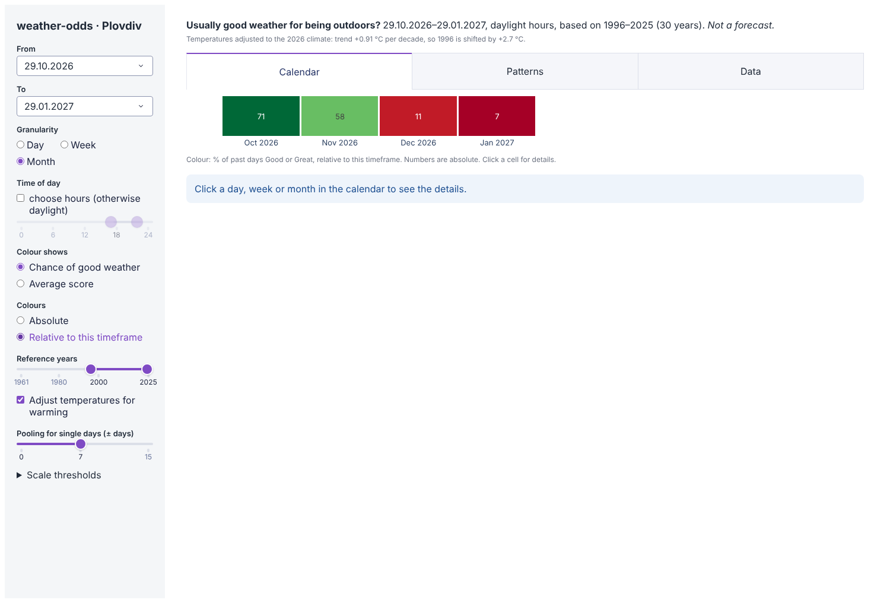

# Dashboard frameworks

_Checked on 2026-10-29 for issue [#8](https://github.com/valentina98/weather-odds/issues/8). Versions and licences are from PyPI; the click-event APIs were confirmed in each package's released code._

**Recommendation: Streamlit for v1** (a first prototype confirms it; see [first results](#first-results-streamlit-prototype)). It needs the least code for our screens, and another developer starts it with one command. It also reports clicks on a chart, which the calendar needs to open the detail panel. If its full-page reruns or limited layout control get in the way, **Dash** is the fallback. The statistics stay in a separate package (see [architecture](../spec/architecture.md)), so switching frameworks later only means rewriting the screens.

## What the dashboard has to do

From the answers in [#10](https://github.com/valentina98/weather-odds/issues/10) and [#6](https://github.com/valentina98/weather-odds/issues/6):

- Controls: timeframe (default today + 3 months), optional time of day (default daytime), granularity (default week), and a reference-year range narrower than the configured default.
- Main view: a calendar coloured green to red by the weather-quality scale.
- Clicking a day, week or month cell opens a detail panel for that period and time of day.
- Two more tabs: Patterns and Data.
- It runs locally only, and another developer can install and start it with documented commands.

## Comparison

| Framework (version, licence) | How it works | Pros for weather-odds | Cons for weather-odds |
|---|---|---|---|
| **Streamlit** 1.66 (Apache-2.0) | A Python script that re-runs top to bottom on every interaction; results are cached. | Least code. Built-in sidebar, columns, tabs and date inputs. `st.plotly_chart` and `st.altair_chart` return clicked points (`on_select`), enough for "click a cell, show details". Large community, good docs. Built-in app testing (`AppTest`). Start: `streamlit run app.py`. | Every click re-runs the script, so heavy steps must be cached explicitly. Limited control over exact layout and styling. Click selection works on point-like marks: the calendar has to be drawn as square markers (Plotly) or `rect` marks (Altair), not as a Plotly heatmap trace. |
| **Dash** 4.4 (MIT) | Flask app; the layout is a tree of components and callbacks connect inputs to outputs. | Full control over layout (HTML/CSS, Bootstrap components). `clickData` works on any Plotly chart, heatmaps included. Only the affected outputs recompute. Mature, widely used for analytics dashboards. | More code than Streamlit for the same screens: every interaction is an explicit callback, and the wiring gets verbose as the app grows. Browser-based tests need Selenium. |
| **Panel** (HoloViz) 1.10 (BSD) | Reactive parameters; runs as a server (`panel serve`) or inside Jupyter. | Works with almost any plotting library (Bokeh, Plotly, Altair, Matplotlib). Plotly click events are available (`click_data`). Same code runs in a notebook, handy for research. | Steeper learning curve, and the documentation is spread across the HoloViz projects. Smaller community than Streamlit or Dash. Needs Python 3.12+. |
| **Shiny for Python** 1.8 (MIT) | Reactive graph, as in R Shiny: only the outputs that depend on a changed input recompute. | Efficient, predictable updates without manual caching. Clean structure for a medium-sized app. Posit supports it. | Smaller Python ecosystem. Plotly charts and their clicks go through an extra package (`shinywidgets`, a bridge to Jupyter widgets). Fewer ready-made examples. |
| **NiceGUI** 3.18 (MIT) | Event-driven UI built on Vue/Quasar; you write handlers for clicks. | App-like interfaces with fine control. Plotly and ECharts charts report point clicks. | Not made for data apps: tables, caching and layout patterns are more manual. Smaller community for analytics use. |
| **Gradio** 6.31 (Apache-2.0) | Input → function → output demos. | Very quick for a single form. | Built for machine-learning demos. A multi-tab, calendar-driven dashboard fights its model. Not recommended. |
| **Static HTML report** (Plotly or Vega-Lite exported by a CLI) | A command writes an HTML file; no server. | Nothing to run but a browser. Easy to share as a file. | Every combination of timeframe, time of day and reference years must be computed in advance, or the user regenerates the file. The detail panel needs custom JavaScript. Fails the "change it and see" use. |

## First results (Streamlit prototype)

_2026-10-29._ The owner asked to pick one, show first results and then re-evaluate ([#8](https://github.com/valentina98/weather-odds/issues/8)). Streamlit was picked, and a throwaway [prototype](../../research/prototype/README.md) of about 250 lines shows the calendar, the inputs and the detail panel with real ERA5 data for Plovdiv.

_Week view, default inputs (today + 3 months, daylight hours, 1996–2025, trend-adjusted). The week of 09.11. was clicked._

_Day view: a month-style calendar. The selection carries over to the matching day._

_Month view with relative colours: the best month of the timeframe is green, while the numbers stay absolute._

**What worked**
- All requested inputs exist as ready-made widgets. Dates are shown as dd.mm.yyyy without extra code.
- Clicking a calendar cell opens the detail panel. The calendar is an Altair chart whose cells report clicks (`on_select`); no JavaScript was needed.
- Changing an input re-runs the script in 0.1–0.3 seconds, because the data and the scoring are cached per set of inputs (measured with Streamlit's test runner).
- About 250 lines for the whole prototype, including the detail panel and the three tabs.

**What needed work-arounds**
- **Chart heights include the axes.** A 60-pixel row left no room for the cells. This was found only by testing four variants; the fix is a taller chart.
- **Selections persist across views.** A week selected before switching to months pointed at a cell that no longer existed and crashed the page until guarded.
- **Every click re-runs the whole script**, so everything slow must be cached explicitly. The first start takes about 18 seconds, mostly reading the research cache (gzipped CSV); a Parquet cache in the real tool would cut that to a few seconds.
- **Layout is fixed to Streamlit's look**: sidebar, tabs, metric boxes. The calendar can only look like what Vega-Lite draws. The "Deploy" button shows unless it is hidden in the Streamlit config.

**Assessment so far:** Streamlit is good enough for v1. The work-arounds were small, and none blocks a requirement. Dash would remove the rerun model and give full layout control, at the cost of more code per screen. Unless the owner wants a different look or finds the reruns too slow, the recommendation stays Streamlit.

## Streamlit and Dash side by side

_2026-10-29._ As asked in [#8](https://github.com/valentina98/weather-odds/issues/8), the same screens were also built in Dash ([`dash_app.py`](../../research/prototype/dash_app.py)). Both prototypes call the same data and statistics code ([`model.py`](../../research/prototype/model.py)), so they show identical numbers; only the screens differ.

| Streamlit | Dash |
|---|---|
|  |  |
|  |  |
|  |  |

| | Streamlit | Dash |
|---|---|---|
| Screen code (shared statistics: 137 lines) | 150 lines | 219 lines |
| Calendar | Altair chart, fixed width; the selected cell is shown by fading the others | Plotly heatmap across the full width; the selected cell gets an outline |
| Detail panel | Built-in metric boxes and columns | Cards and layout written by hand (inline styles) |
| Look | Streamlit's standard style; little to change | Any layout and style; default widgets (tabs, sliders) look plain until styled |
| Clicking a cell | Works through `on_select`; needed a guard when the view changes | Heatmap clicks carry only the cell's x/y labels, so a lookup from position to period was needed |
| Speed after the first start | Script re-runs in 0.1–0.3 s | Callbacks take 0.04–0.2 s |
| First start (research cache) | about 18 s | about 21 s |
| Start command | `streamlit run app.py` | `python dash_app.py` |
| Testing | `AppTest` runs the script without a browser | Callbacks are plain functions and can be called directly in tests |

**What Dash does better**
- The full-width calendar is easier to read, and the outline makes the selection clear.
- Full control over the layout, e.g. cards in a row.
- No full re-run on every click.

**What Streamlit does better**
- About a third less screen code.
- Widgets look finished without any styling.
- The selection works without a lookup table.

**Assessment:** both meet every requirement, and neither found a blocker. Dash gives more control over the look for about 45% more screen code. Following the rule set in #8 ("keep Streamlit unless we find something better in Dash, or Dash looks better"), the choice now depends on which look the owner prefers in the screenshots above.

## Decision needed

In [#8](https://github.com/valentina98/weather-odds/issues/8): **Streamlit** (simpler) or **Dash** (more control over the look). The choice does not affect the data or statistics design.
