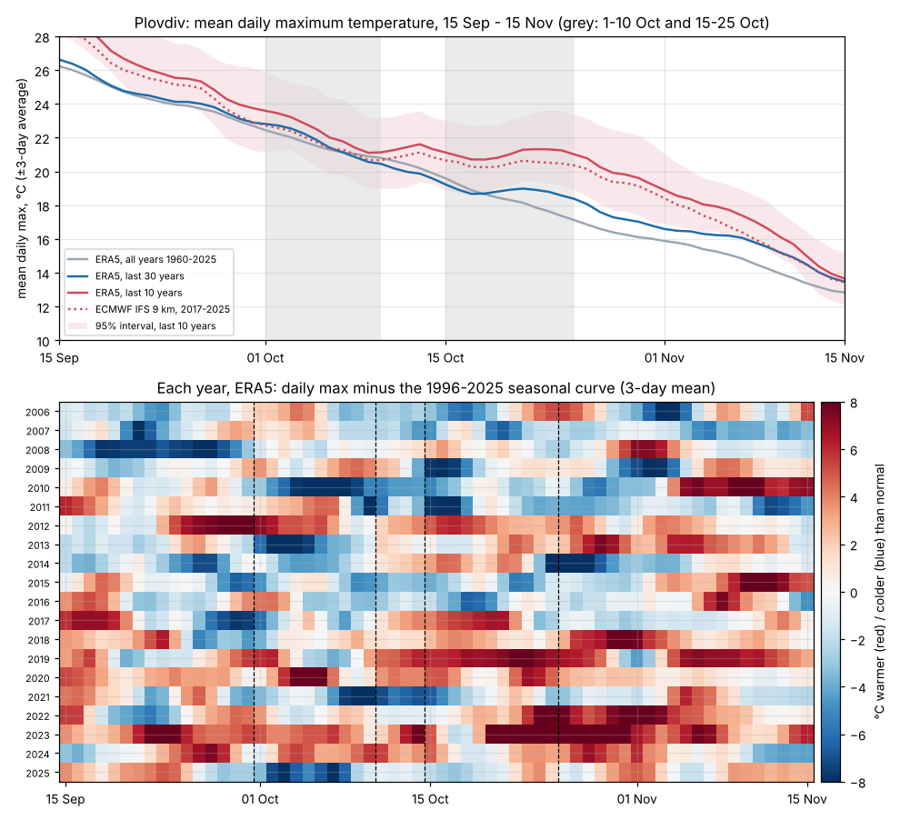

# Early October: does it warm up, then get colder again?

_Run on 2026-10-29 with [`research/analyze_ranges.py`](../../research/analyze_ranges.py) for issue [#3](https://github.com/valentina98/weather-odds/issues/3). All numbers are in [early-october.json](early-october.json)._

**Short answer: not in early October.** In every source and every range of years, 1–10 October is about 2–3 °C cooler than 21–30 September. In the last 10 years, it was cooler in all 10 years. What the recent data does show is a **pause in the autumn cooling around 15–25 October** in the last 10–15 years. It appears in all three gridded sources, but it is not statistically significant. It comes from a few very warm late Octobers (2017–2019, 2022, 2023), and it was found by looking at the chart. It is a hint to re-check with station data, not a pattern the tool should report yet.

_Top: mean daily maximum, averaged over ±3 days, for different ranges of years. Bottom: each year since 2006, red where it was warmer than the 1996–2025 seasonal curve. The dashed lines mark 1–10 Oct and 15–25 Oct._

## What was tested

Daily maximum temperature, from every source reachable from this session, for six ranges of years:

| Source | Grid | Years |
|---|---|---|
| ERA5 | 25 km | 1960–2025 |
| ERA5-Land | 9 km | 1960–2025 |
| ECMWF IFS (operational model archive) | 9 km | 2017–2025 |
| Station (NOAA GSOD + Meteostat) | point | not reachable from this session yet; re-run when it is |

Two windows, each against the ten days before and after it:

- **1–10 October**, as described in [#3](https://github.com/valentina98/weather-odds/issues/3): compared with 21–30 Sep and 11–20 Oct.
- **15–25 October**, chosen after seeing the chart: compared with 5–14 Oct and 26 Oct – 4 Nov.

Two numbers per window, with 95% intervals from resampling whole years:

- **Change:** the window's mean minus the mean of the ten days before. Positive means it warms up into the window. Normal autumn cooling is about −2 to −3 °C per ten days.
- **Hump:** how far the window sits above the smooth seasonal curve, compared with the days before and after. Positive means "warmer, then colder again".

## Results

**1–10 October** (ERA5; ERA5-Land and IFS agree within 0.5 °C)

| Years | Change from 21–30 Sep | Hump | Years warmer than 21–30 Sep |
|---|---|---|---|
| Last 10 (2016–2025) | −2.8 °C (−4.4 to −1.4) | −0.8 °C (−2.1 to +0.4) | 0 of 10 |
| Last 15 (2011–2025) | −3.0 °C (−4.3 to −1.8) | −0.9 °C (−2.1 to +0.2) | 0 of 15 |
| Last 20 (2006–2025) | −2.5 °C (−3.9 to −1.1) | −0.4 °C (−1.6 to +0.8) | 3 of 20 |
| Last 30 (1996–2025) | −2.2 °C (−3.2 to −1.1) | 0.0 °C (−0.9 to +0.9) | 5 of 30 |
| 1960–1995 | −2.2 °C (−3.2 to −1.3) | −0.3 °C (−1.1 to +0.5) | 9 of 36 |
| All (1960–2025) | −2.2 °C (−2.9 to −1.5) | −0.1 °C (−0.7 to +0.4) | 14 of 66 |

ECMWF IFS, 2017–2025: −3.0 °C (−4.6 to −1.7), hump −1.0 °C (−2.1 to +0.05), 0 of 9 years warmer.

**Verdict:** early October cools at the normal rate. Recent years are no exception: in the last 10 and 15 years it cooled, if anything, slightly faster, and not a single year was warmer than late September.

**15–25 October** (chosen after seeing the chart)

| Years | Change from 5–14 Oct | Hump | Years warmer than 5–14 Oct |
|---|---|---|---|
| Last 10 (2016–2025) | −0.5 °C (−1.8 to +0.9) | +0.7 °C (−0.6 to +2.1) | 5 of 10 |
| Last 15 (2011–2025) | −0.8 °C (−2.0 to +0.3) | +0.7 °C (−0.4 to +1.9) | 7 of 15 |
| Last 20 (2006–2025) | −1.2 °C (−2.3 to −0.1) | +0.5 °C (−0.4 to +1.5) | 8 of 20 |
| Last 30 (1996–2025) | −1.9 °C (−2.9 to −0.8) | 0.0 °C (−0.7 to +0.9) | 11 of 30 |
| 1960–1995 | −3.1 °C (−4.0 to −2.3) | −0.3 °C (−1.2 to +0.6) | 3 of 36 |

ERA5-Land and IFS give the same picture: hump +0.5 and +0.6 °C for the last 10 years, intervals including zero.

**Verdict:** in recent years the temperature drop pauses in the second half of October, and roughly every second year that period was warmer than the ten days before. It was rare before 1996. The intervals include zero and the window was picked after looking, so this is **not established**. It matches the "warmer, then colder again" experience, but about two weeks later than described.

## What this means for the tool

- Early October is not a recurring warm spell. The [phase-0 check](plovdiv-data-check.md) reached the same conclusion with 30–66 years; this check adds the last 10–20 years and two more sources.
- The odds already show the effect of recent warm late Octobers when the reference years are narrowed to the last 10–15 (requirement F19).
- Re-run this check with station data once the network allows it, and again each year. The late-October pause becomes a "slight tendency" in the Patterns tab only if it passes the pattern tests in the [methodology](../spec/methodology.md#8-recurring-patterns).

## Reproduce

See [research/README.md](../../research/README.md).
