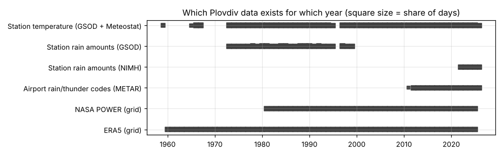
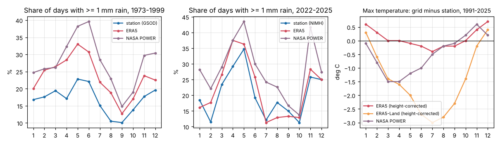
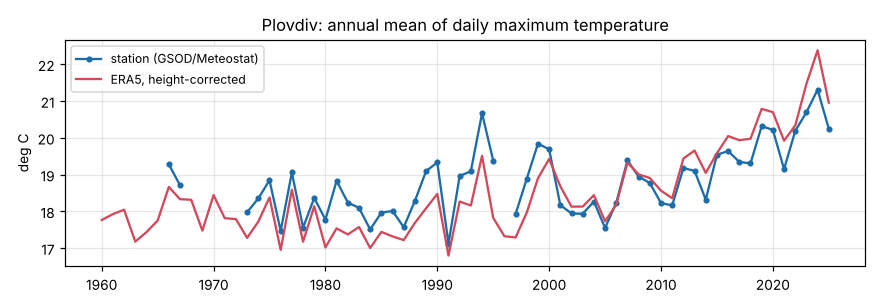
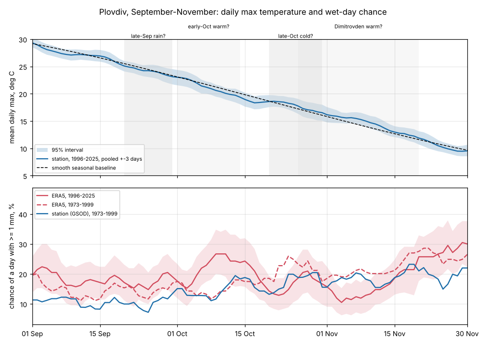
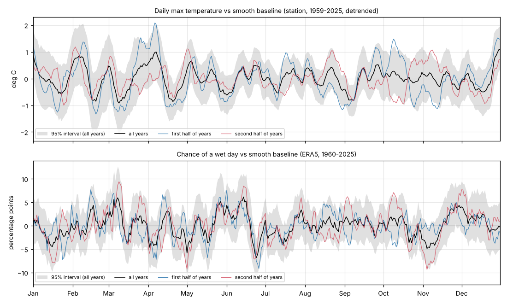
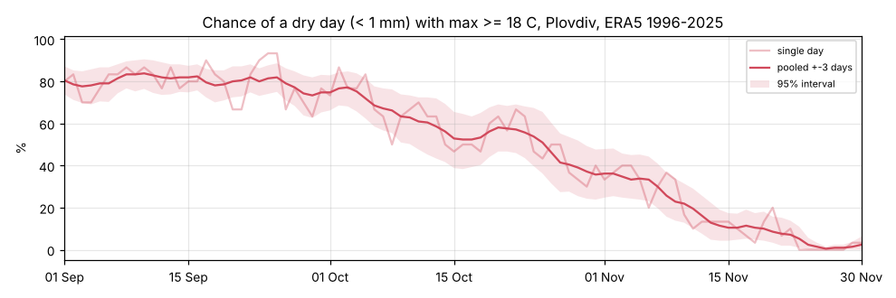
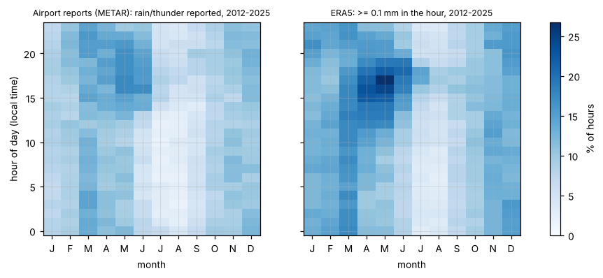

# Plovdiv data check (phase 0)

_Run on 2026-10-28 with [`research/analyze_plovdiv.py`](../../research/analyze_plovdiv.py). All numbers are in [plovdiv-data-check.json](plovdiv-data-check.json)._

**Questions**

1. Are the autumn patterns the owner described real?
   - rain at the end of September
   - a warm, sunny spell in early October
   - a cold turn at the end of October
2. How good are the free data sources for Plovdiv?
3. How noisy are daily statistics?
4. When during the day does it rain?

**Short answers**

1. **Not as calendar patterns.**
   - In 30–66 years of data, late September is not wetter than the weeks around it.
   - Early October is not warmer than the smooth seasonal curve.
   - Late October has no special cold turn.
   - What people experience is the **steep normal autumn decline**: the chance of a dry day of at least 18 °C falls from 68% in early October to 49% in late October and 26% in early November.
2. **ERA5 is good for temperature, too wet for rain.**
   - ERA5, corrected for height, matches the Plovdiv station's daily maximum temperature within 0.1 °C on average.
   - The finer ERA5-Land runs 2–3 °C too cool in summer.
   - ERA5 counts more wet days than the station: 39% more in 1973–1999, 8% more in 2022–2025.
3. **Single days are very noisy.** With 30 years of data, a single date's rain chance is uncertain by ±15 percentage points. Pooling a week (±3 days) brings that to ±7.
4. **Early-summer rain falls mostly in the afternoon and evening.** In June, rain is reported about three times as often at 14–20 h as before noon.

## Data used

| Data | Period | Notes |
|---|---|---|
| Station temperature (NOAA GSOD, gaps filled with Meteostat) | 1959–2025, with gaps (1960–64, 1968–72, 1996) | WMO 15625 Plovdiv |
| Station rain amounts, NOAA GSOD | 1973–1999 | No amounts after 2000 |
| Station rain amounts, NIMH open data | 2022–2026 | Station 46011 Plovdiv; unverified operational data |
| Airport rain/thunder reports, METAR (LBPD) | 2012–2026 | Weather codes are missing in the archive before ~2012 |
| ERA5 (0.25°) from Open-Meteo's AWS open data | 1960–2025, hourly | Grid cell 42.25 N, 24.75 E, 271 m. Temperatures shifted to the station's 179 m (+0.6 °C). |
| ERA5-Land (0.1°), same source | 1960–2025, hourly | Grid cell 42.10 N, 24.80 E, 304 m |
| NASA POWER (~0.5°) | 1981–2025, daily | |

The Open-Meteo API (including CERRA) was over its free daily limit from the cloud session, so CERRA is not part of this check.

## 1. How the sources compare

**Daily maximum temperature vs the station, 1991–2025 (12,386 days)**

| Grid source | Mean difference | Mean absolute difference | Correlation | Seasonal pattern |
|---|---|---|---|---|
| **ERA5**, height-corrected | **+0.1 °C** | 1.2 °C | 0.987 | +0.6 °C in winter, −0.4 °C in July |
| ERA5-Land, height-corrected | −1.5 °C | 2.4 °C | 0.976 | **−2.7 to −3.0 °C in June–August** |
| NASA POWER | −0.5 °C | 2.1 °C | 0.964 | −1.5 °C in spring |

All nine ERA5-Land cells around Plovdiv show the same summer cold bias (checked for July 2020), so it is not a single bad grid cell. **Finer resolution does not mean more accurate here.** The tool must check each gridded source against station data where it can.

**Wet days (≥ 1 mm)**

| Period | Station | ERA5 | NASA POWER | ERA5 agrees with the station on |
|---|---|---|---|---|
| 1973–1999 (GSOD) | 16.8% of days | 23.4% | 27.7% | 84% of days |
| 2022–2025 (NIMH) | 20.3% | 22.0% | 28.1% | 81% of days |

ERA5 rains too often, mostly in light amounts and most strongly in spring and early summer (May 1973–1999: 33% of days in ERA5 vs 23% at the station). The gap is much smaller against NIMH for 2022–2025. Either ERA5 has improved for recent years, or the NIMH files undercount, because blank cells may hide missing reports. The monthly shape is right in both periods. **Rain chances from ERA5 need calibrating** against station data, for example by raising the wet-day threshold until the frequencies match.

## 2. Warming

| Series | Trend since 1960 | Trend since 1980 |
|---|---|---|
| Station | +0.30 °C per decade | +0.42 °C per decade |
| ERA5 | +0.45 °C per decade | +0.84 °C per decade |

ERA5's mean daily maximum for 1996–2025 is **1.55 °C higher than for 1961–1990**. The station trend is smaller, but its record has gaps and mixes two data products, so the exact rate is uncertain. Either way, "typical" should be based on recent years (proposed: the last 30).

## 3. The autumn patterns

The grey bands mark the periods tested. In the top panel, a real pattern would show the blue curve leaving the dashed smooth baseline by more than its shaded interval.

**Fortnight averages**

| | 1–14 Sep | 15–30 Sep | 1–14 Oct | 15–31 Oct | 1–14 Nov | 15–30 Nov |
|---|---|---|---|---|---|---|
| Mean daily max, station 1996–2025 | 27.6 °C | 24.8 °C | 21.2 °C | 17.9 °C | 15.1 °C | 11.1 °C |
| Wet-day chance, ERA5 1996–2025 | 19.0% | 17.7% | 21.7% | 18.4% | 12.6% | 25.0% |
| Wet-day chance, station 1973–1999 | 10.0% | 10.9% | 14.2% | 17.0% | 17.1% | 20.8% |
| Chance of a dry day ≥ 18 °C, ERA5 1996–2025 | 80% | 79% | 68% | 49% | 26% | 6% |

**Verdicts**

| Pattern | Test | Result | Verdict |
|---|---|---|---|
| **Rain at the end of September** (20–30 Sep) | Wet-day chance vs the smooth seasonal curve | ERA5 1996–2025: +1.1 points (95% interval −2.7 to +4.6). ERA5 1960–2025: +0.3 (−2.2 to +3.1). Station 1973–1999: −1.9 (−5.7 to +1.9). | **Not supported.** Rain becomes gradually more frequent through autumn; late September is not special. |
| **Warm early October** (1–14 Oct) | Daily max vs the smooth curve | All years, detrended: +0.16 °C (−0.42 to +0.71). 1996–2025: −0.34 °C (−1.12 to +0.49). | **Not supported** as a calendar pattern. |
| Warm spells in general | Share of years with ≥ 3 days at least 3 °C above the seasonal curve, per fortnight (55 years) | 1–14 Sep: 25%. 15–30 Sep: 44%. **1–14 Oct: 45%**. 15–31 Oct: 49%. 1–14 Nov: 38%. 15–30 Nov: 38%. | Warm spells are **common all autumn** (in roughly every second year in each fortnight), but not more common in early October. |
| **Rain at the end of September, then warm** (sequence) | Early-October temperature after a wet vs a dry late September (≥ 3 wet days on 20–30 Sep; 18 of 55 years were wet) | After a wet late September, early October averaged **0.48 °C cooler** than normal. After a dry one, **0.55 °C warmer**. Warm early Octobers: 50% vs 62% of years. Correlation −0.28. | **The opposite holds:** a dry late September tends to continue into a warm early October (persistence). |
| **Cold end of October** (20–31 Oct) | Daily max vs the smooth curve | All years: −0.03 °C (−0.65 to +0.59). 1996–2025: +0.46 °C (−0.34 to +1.21). | **No special cold turn.** The temperature falls steadily by about 3 °C per fortnight. Because so many days hover around comfortable temperatures, the chance of a pleasant day **drops fast** in the second half of October (68% → 49%). |
| **Late-autumn warm spell from Dimitrovden** (26 Oct – 20 Nov) | Daily max vs the smooth curve | +0.04 °C (−0.32 to +0.44) | **No temperature signal.** ERA5 shows a **drier spell around 1–10 November** (about −5 points around 4 Nov; both halves of the record agree). That fits the "stable high pressure" description, but the station data for 1973–1999 does not show it. Candidate only. |
| First autumn frost | Station minimum < 0 °C, 1996–2025 (29 years) | Median **8 November**. Earliest 5 Oct, latest 15 Dec. Before 1 Nov in 31% of years; before 15 Nov in 62%. | Useful fact for evening events and hikes. |

**What this means:** the owner's experience is right about the *outcome*: early October is usually still pleasant, and late October often isn't. The cause is the normal steep autumn decline plus large year-to-year swings, not a recurring calendar event. A tool that shows the day-by-day odds captures this better than a list of named patterns.

## 4. Whole-year scan for recurring patterns

The same test applied to every day of the year:
- the curve pooled over ±3 days must leave the smooth curve
- the 95% interval must exclude zero for at least 5 days in a row
- the departure must point the same way in both halves of the record

| Candidate | Size | Evidence |
|---|---|---|
| **3–8 September cooler** | −0.8 °C | Passes all tests, with all three baseline shapes tried (2, 3 and 4 harmonics). The most robust temperature pattern found: a first late-summer cool-down. |
| **17–23 April cooler** | −0.8 °C | Passes with 2 of 3 baseline shapes. |
| 22–26 June drier | −6 to −7 points | Passes with 1 of 3 baseline shapes; follows a wetter mid-June (+6 points around 14 Jun). |
| Around 30 December warmer | +1.1 °C | Interval excludes zero, both halves agree, but fewer than 5 days. Resembles the European "Christmas thaw". |
| Around 4 November drier | −4.9 points | See above. |
| Around 1 May drier, around 8 March wetter, around 26 November wetter | ±5–6 points | Single-day significance only. |

With 365 days tested, a few chance hits are expected. **Plovdiv has no strong calendar singularities.** The candidates are small (about 1 °C or 5 percentage points) compared with year-to-year swings. They are worth showing as "slight tendencies" with their evidence, not as rules.

## 5. How noisy is a single day?

Median half-width of the 95% interval with 30 years of data:

| Pooling window | Wet-day chance | Mean daily max |
|---|---|---|
| Single day (±0) | ±15.0 points | ±1.6 °C |
| ±3 days (one week) | ±6.9 points | ±1.1 °C |
| ±7 days (two weeks) | ±5.1 points | ±0.9 °C |
| ±15 days (a month) | ±3.4 points | ±0.7 °C |

**Daily views must pool neighbouring days.** A single date's rain chance from 30 years is mostly noise; ±3 days is a reasonable default, and month or week views are the honest choice for rain.

## 6. Rain by hour of day

- **Airport reports, 2012–2025:** rain or thunder is reported in 9.0% of hours. In **June**, about 4–8% of hours from midnight to noon versus **13–17% from 14:00 to 20:00**. In October the rate is flat at 7–10% at every hour.
- **ERA5:** ≥ 0.1 mm in 11.6% of hours. The afternoon peak in April–June comes at about the same hours (16–18 h) but is **stronger**: up to 21–27% of hours, against 15–18% in the airport reports.
- **For events:** in early summer, an evening event faces about three times the rain risk of a morning one. The event-window feature matters, and ERA5's hourly rain frequency needs calibrating against observations where possible.

## Implications for the spec

1. **The product is the day-by-day odds and the event-hour detail.** Named patterns are a secondary, evidence-labelled feature.
2. **Use ERA5 temperatures (height-corrected) by default, not ERA5-Land**, at least for Plovdiv. Validate every gridded source against stations where they exist.
3. **Calibrate ERA5 rain** against station wet-day frequencies (GSOD 1973–1999, NIMH from 2022) and against airport hourly reports.
4. **Reference period: the last 30 years**, because of the warming.
5. **Default pooling ±3 days**, with intervals always visible.
6. **Next data checks:**
   - CERRA (needs the Open-Meteo API from a personal computer, or a CDS key)
   - a mountain location, for elevation correction
   - NIMH stations near hiking areas

## Reproduce

See [research/README.md](../../research/README.md).
