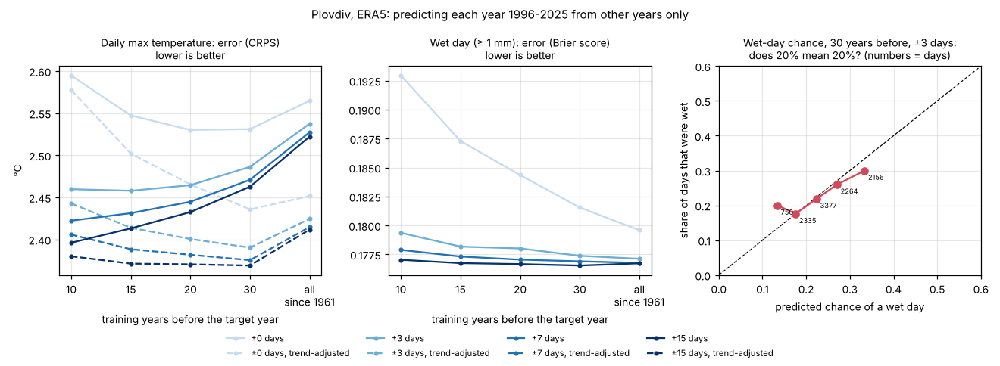

# Cross-validation: how good are the historical odds?

_Run on 2026-10-29 with [`research/validate_odds.py`](../../research/validate_odds.py) for issue [#7](https://github.com/valentina98/weather-odds/issues/7). All numbers are in [validation.json](validation.json)._

**Short answer:**
- Each year from 1996 to 2025 was predicted only from other years' statistics. **Temperature odds are informative, but the warming makes plain 30-year statistics about 1 °C too cold.** Shifting older years by the warming trend fixes most of that and lowers the error by about 0.1 °C.
- **Pooling ±7 days beats ±3 days** for both temperature and rain.
- **Rain odds barely beat a flat chance:** at Plovdiv the chance of a wet day hardly changes through the year.

Proposed defaults from this: the last 30 complete years, ±7-day pooling, and trend adjustment for temperature. Trend adjustment needs the owner's confirmation; see [open questions](../open-questions.md).

## How it was tested

As suggested in [#7](https://github.com/valentina98/weather-odds/issues/7): pretend one year's weather is unknown, predict it from other years, score the prediction against what happened, and repeat for every year. Here "predict" means only what the tool will show: the statistics of past years for that date. No current weather is used.

- **Target years:** 1996–2025, every day. Data: ERA5 at Plovdiv; station data replaces or checks it when reachable.
- **Training years:**
  - **"N years before":** only the N years before the target year (N = 10, 15, 20, 30, or all since 1961). This is exactly what the tool would have known at the time, so it is the honest test.
  - **"All other years":** also uses years after the target. This is the leave-one-year-out variant from #7. It looks slightly better because later years share the target year's warmer climate, which the real tool cannot know.
- **Pooling:** each date uses the training years' values from ±0, 3, 7 or 15 days around it.
- **Trend adjustment** (temperature only): each training year is shifted by the linear warming trend fitted to the training years. For example, a year 20 years before the target is shifted by 20 × the trend per year.
- **Scores** (lower is better):
  - **CRPS** for daily maximum temperature: the average error of the whole predicted distribution, in °C.
  - **Brier score** for the chance of a wet day (≥ 1 mm): the squared error of the predicted chance.
  - **Bias:** observed minus predicted mean.
  - **Coverage:** how often the day fell inside the predicted 10–90% range. 80% is right.

## Results

**Daily maximum temperature** (whole year; Sep–Nov behaves the same)

| Training years | Pooling | Trend-adjusted | CRPS | Bias | In 10–90% range |
|---|---|---|---|---|---|
| 30 before | ±3 days | no | 2.49 °C | +1.07 °C | 77% |
| 30 before | ±7 days | no | 2.47 °C | +1.07 °C | 77% |
| **30 before** | **±7 days** | **yes** | **2.38 °C** | **+0.32 °C** | **79%** |
| 30 before | ±15 days | yes | 2.37 °C | +0.32 °C | 81% |
| 10 before | ±7 days | no | 2.42 °C | +0.51 °C | 79% |
| 10 before | ±7 days | yes | 2.41 °C | +0.03 °C | 79% |
| All since 1961 | ±7 days | no | 2.53 °C | +1.27 °C | 75% |
| All since 1961 | ±7 days | yes | 2.41 °C | +0.75 °C | 77% |
| 30 before | ±0 days | no | 2.53 °C | +1.07 °C | 78% |
| All other years of 1996–2025 (uses later years) | ±7 days | no | 2.44 °C | 0.00 °C | 80% |

- **Trend adjustment** lowers the 30-year error by 0.10 °C (95% interval 0.06–0.14, at ±3 days) and removes most of the cold bias.
- **Without trend adjustment, fewer years are better:** the last 10 years beat the last 30. That matches the warming. With trend adjustment, 30 years are slightly better than 10, because more years mean less noise.
- **Pooling:** ±7 days is better than ±3 by a small but clear 0.016 °C (0.009–0.022). ±15 is better still, but it blurs real changes within a month.

**Chance of a wet day**

| Training years | Pooling | Brier score |
|---|---|---|
| 10 before | ±0 days | 0.193 |
| 30 before | ±0 days | 0.182 |
| 30 before | ±3 days | 0.1774 |
| **30 before** | **±7 days** | **0.1769** |
| 30 before | ±15 days | 0.1765 |
| All since 1961 | ±7 days | 0.1768 |

- **Pooling matters most:** a single date's chance from 10 or 30 years is clearly worse.
- Beyond ±7 days, and beyond 20–30 years, the gains are tiny.
- The default settings (30 years, ±3 days) are only **0.8% better than a flat chance** (Brier skill score 0.008). A flat chance means the same wet-day chance on every day of the year, from the same 30 years. At Plovdiv, the wet-day chance in ERA5 (±7 days, 1996–2025) varies only between 12% in late August and 35% in late May. Each year's rain falls on different days, so a calendar cannot say much about which week will be wet.
- **Reliability** (right panel): mid-range chances are right (predicted 22%, observed 22%), but the extremes are too extreme (predicted 13% → observed 20%; predicted 33% → observed 30%). Part of the calendar's variation in rain chance is noise. Wider pooling or a seasonal smoothing of the rain chance would help.

## What this means for the tool

1. **Default pooling: ±7 days** (was ±3), for both temperature and rain. The user can still choose ±0–15.
2. **Default reference period: the last 30 complete years** (the owner's choice), with **trend adjustment for temperature** proposed as the default. Without it, the tool would show temperatures about 1 °C colder than the climate they are used in.
3. **Rain should be shown as a broad chance**, not as a day-by-day signal. The colour of a week should not jump because of rain noise. This supports pooling and the monthly/weekly views for rain.
4. The weather-quality scale ([methodology §4](../spec/methodology.md#4-outdoor-weather-scale)) will be validated the same way once its definition is confirmed.
5. Repeat with station data (temperature from GSOD/Meteostat, rain from NIMH) once the network allows it.

## Reproduce

See [research/README.md](../../research/README.md).
