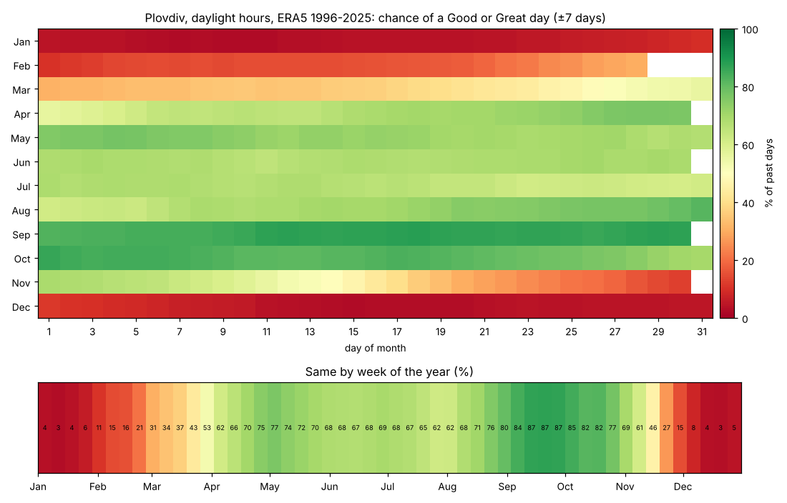

# Outdoor-weather scale: preview for Plovdiv

_Run on 2026-10-29 with [`research/preview_scale.py`](../../research/preview_scale.py) for issue [#5](https://github.com/valentina98/weather-odds/issues/5). Numbers are in [scale-preview.json](scale-preview.json)._

**What the proposed scale gives for Plovdiv.** **September (86%) and October (80%)** are the months with the best chance of good weather in daylight. Next come May (72%) and August (71%), then April, June and July (65–68%). July is held back by afternoon heat. November drops to 43%, and December to February are mostly cold (5–18%). The definition is in [methodology §4](../spec/methodology.md#4-outdoor-weather-scale). This is a proposal for the owner to confirm or adjust.

_Chance that a past day rated Good or Great (score 60 or more) in daylight hours. ERA5, 1996–2025, ±7-day pooling. Top: by date, like a year calendar. Bottom: by week of the year. In the dashboard the calendar shows only the chosen timeframe, at the chosen granularity._

## How the scale works, in short

- **Every hour** gets 0–100. Comfortable is 18–26 °C. The score falls towards 0 °C and towards 38 °C, so extreme heat is bad weather. Any rain in the hour lowers it strongly; gusts above 30 km/h lower it.
- **A day** (chosen hours, default daylight) is the mean of its hours. It is capped at Fair with 1 mm of rain or more, and at Poor with 5 mm or more.
- **Five classes:** Great (80+), Good (60+), Fair (40+), Poor (20+), Bad.
- **The calendar colour** is the share of past days that rated Good or Great, from red (0%) to green (100%).

## What lowers the score at Plovdiv

Average shortfall of each factor over daylight hours (0 = never a problem, 1 = always the worst):

| Month | Temperature | Rain | Wind | Chance of a Good or Great day |
|---|---|---|---|---|
| Jan | 0.77 | 0.05 | 0.01 | 5% |
| Apr | 0.23 | 0.07 | 0.02 | 68% |
| May | 0.09 | 0.07 | 0.01 | 72% |
| Jul | 0.19 (heat) | 0.04 | 0.01 | 65% |
| Sep | 0.09 | 0.04 | 0.01 | 86% |
| Oct | 0.20 | 0.05 | 0.01 | 80% |
| Nov | 0.44 | 0.05 | 0.01 | 43% |

- **Temperature decides most of the year.** Cold dominates from November to March, heat in July and August.
- **Rain matters on the days it falls** (through the caps), but it falls on few daylight hours, so its average shortfall is small.
- **Wind rarely matters** in the Plovdiv basin: gusts above 30 km/h are uncommon.

Across all days of 1996–2025: 31% Great, 21% Good, 22% Fair, 15% Poor, 11% Bad.

## Choices for the owner

1. **Thresholds:** is 18–26 °C the right "no penalty" range? Should 32 °C already count as quite bad? (It currently scores about 0.5 on temperature.)
2. **Rain:** should any rain in the chosen hours prevent a Good rating, or only 1 mm or more (current proposal)?
3. **Calendar colour:** the chance of a Good or Great day (proposed), or the mean score?
4. **Absolute or relative to the season:** absolute (proposed) makes winter red. Relative would show the best winter weeks in green.

## Limitations of this preview

- ERA5 only; no station calibration yet. ERA5 has too many light-rain hours, so rain is slightly over-penalised.
- No thunder: ERA5 has no thunder variable (methodology §5).
- No trend adjustment: summer heat is slightly underestimated for today's climate.
